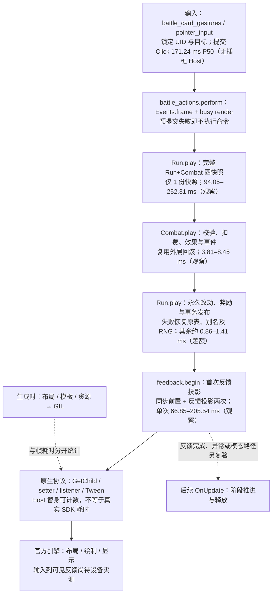

# 战斗运行时性能与渲染架构 · 隔离实验

**结论：GO 留档和后续同包实机复验；NO-GO 集成两项候选。** 当前热点仍是一次完整快照和两次同步战斗投影，不是规则计算。没有在同口径下得到稳定的端到端尾延迟收益。

**基线：** FurinyaWorks `develop` `32a15219aecd145c59cb1b2fcf477e5556766e5d`（树 `1256fecdf9ae57019d65a77bb4733cbaa00cf3c6`）。仅在 Fork B 归档。与 v2.2 发版无关，不修改主仓、Release、CI 门禁或正式资源。

## 先分清三条时间轴

1. **输入与同步提交**：对一小段同步输入事件计时，分离事件进入、预提交表现保护、快照、规则、Run 发布和首个反馈提交。
2. **继续更新直到可交互**：从输入返回到后续 Update/反馈完成；报告稳态 step 和单次最大值，不用动画设计时长替代 CPU。
3. **屏幕首帧**：正确变化首次被官方客户端绘制到屏幕，需隔离存档上的同包实机；离线控件写入、SDK step、模拟器 screenshot 和设备帧率不是同一指标。

### 历史证据与可比性

[11-10 十牌双敌证据](../../docs/evidence/battle-input-performance-20261110/README.md)：d98 派生 GIL，私有 SDK renderer/driver；120 个稳态 step P50/P95 为 5.61/8.54 ms，三次真实提交 Up 为 143.51/135.94/132.44 ms（不是 P95），结束回合 Up 148.03 ms。另一次插桩采样见完整快照约 98–109 ms、规则约 3.8–4.4 ms，包含嵌套的刷新约 92–130 ms；不同候选与运行，严禁相加或直接和此次 Host 数值比较。

[11-25 的 CPU 调用树](../../docs/evidence/v2.1.1-performance-20261125/runtime/cpu-lua-call-tree.svg) 和[分析](../../docs/evidence/v2.1.1-performance-20261125/runtime/RUNTIME-PROFILE.md)：证明调用计数、采样钩子本身改变耗时甚至分帧；本轮同样将普通 A/B 与插桩归因拆开。

## 当前调用链

在官方表现分支中，`feedbackPresented` 允许第一反馈帧替代成功路径尾部的额外全量刷新；拖拽路径也避免完成动作前重刷非 busy 全页。因此不能把历史的“三次满屏刷新”直接写成最新行为，也不能为了数字移除 busy 预提交保护。

## 原生调用及资源生命周期

单敌平台分解使用当前正式资源选项和移动画布 1560×720；75 张牌夹具、实际抽到 10 张，3 次真实选牌/提交及反馈结算。与十牌双敌操作 A/B 不是同一个战斗。以下是 Host 契约替身，不是官方平台内部读数。

| 观察阶段 | 样本结果 |
|---|---|
| 十张手牌保持，60 次更新 | 13,204 次替身方法，26,126 次字段写入；底层查询另计 60 次画布尺寸、61 次指针位置 |
| 连续出牌 3 次及结算 | 57,240 次替身方法，65,902 次字段写入，3 次事务快照，其中 GetChild 33,702、SetVisible 11,300；0 次模板创建 |
| 冷启 → 首战 → 十牌 | 注册且存活的替身控件数 25,689 → 26,317 → 26,317；十牌按祖先可见性启发式为 3,222 |
| 首开 → 暖开牌库 | 首开净增 3,160 个控件（10 个卡根、50 个分段，共 60 次模板创建）；暖开 0 次创建，仍 29,477 存活；启发式可见 4,290 |
| 销毁 | 更新循环停用，0 存活、0 可见；测试为验证重入仍持有已标记销毁的树，不能据此断言真机 GC 或无泄漏 |

`GetChild`、可见性、卡牌姿态及属性写入是后续原生边界探针的优先级，不是同义调用。字段写入可能发生在方法内部，两列不得相加；不可因“调用次数多”直接推断单次原生 API 耗时，或把模拟墙钟当设备帧时间。替身遍历的进程峰值包含大树和仪器；[原始报告](platform/platform-source-host.json)区分正常计数和额外遍历，分别保留 Node/Fengari 的 RSS、JS 堆样本和生成布局摘要。该正式资源预设产生 **25,688** 个静态布局描述符，另有模板表；这不是同屏可见实例、GIL 字节或平台发布容量。

## 双敌 A/B · 只缓存确定性的文本拟合

复用卡面现有、每个 View 有界的文本拟合缓存。保持标题、正文、字号/可见性、输入事件、玩法提交、动作反馈及全部原生 setter。不合并到游戏源码，保留为独立可重放补丁。

| LuaTeX 源码 Host，8 对 AB/BA 交替新进程 | A | B |
|---|---:|---:|
| 手牌稳态 Update，CPU P50 / P95 / max（各 n=960） | 0.267 / 0.442 / 9.289 ms | 0.254 / 0.407 / 1.377 ms |
| 目标 Down，CPU P50（各 n=24） | 3.019 ms | 2.171 ms |
| 确认出牌 Up+Click，CPU P50 / P95 / max（各 n=24） | 23.637 / 30.148 / 48.753 ms | 18.839 / 28.131 / 30.450 ms |
| 确认出牌 Up+Click，wall P50 / P95 / max | 48.431 / 73.908 / 95.911 ms | 40.190 / **81.949** / 92.113 ms |
| 确认出牌单独计数：3 次操作的文本拟合 / 全量 render 次数 | 102 / 6 | 0 / 6 |
| 确认出牌单独计数：替身方法 / 字段写入 | 14,527 / 18,355 | 14,527 / 18,355 |
| 每进程 RSS 峰值的中位数 / 根控件数 | 111,108 KiB / 25,830 | 108,056 KiB / 25,830 |

CPU 和 wall 的会话内中位数均只在 5/8 对改善；24 个观察不是 24 个独立会话。墙钟为 LuaTeX gettimeofday，非单调计时；共享环境核绑定不是资源限额。目标 Down 的 1 次刷新是瞄准预览；真正提交的 2 次是失败前置保护和首个反馈。两组卡面文本/字号/可见与规则摘要一致；强制首个 render 抛错时，A/B 均未扣体力/能量、选中 UID 未变、未增加事件、UI 未卡 busy。签名不是实机像素一致性证明。见 [补丁和复跑入口](../runtime-perf-ui/)；原始计数与全部样本独立保留。

**NO-GO 进入集成。** 补丁消除了重复拟合，有 CPU 收益迹象，但没有减少真实 UI setter，且输入 wall P95 变差。保留为第二轮可复试对象，不许用单个 CPU 中位数报“玩家体验已改善”。

候选定向回归 **5/5，无跳过**：反馈首帧/预提交失败恢复、十牌双敌互动、虚弱易伤瞄准数值、卡面排版、详情长文溢出。独立复核确认生成数据、对照文件与原始报告散列匹配，缓存覆盖各项排版参数且有上限，不跳过 setter。独立复核也拒绝把可见字段签名当像素一致性证明。

## 双敌 A/B · 快照遍历

另一套双敌夹具使用生产源码 Host、种子 10 的双 Louse与 75 张压力牌库，实际抽到 10 张，走真实监听触发出牌。使用 Node/Fengari、固定 CPU 亲和及 768 MiB **V8 堆上限**；不是 Linux cgroup 内存限额。只改全量遍历里 table key 类型判断，不删全量图、不移除表键遍历、不换快照或回滚语义。

| Node/Fengari，3 对新进程 | A | B |
|---|---:|---:|
| 实际提交 Click P50 / 最大值（各 n=9，P95 即最大） | 171.236 / 347.251 ms | 168.736 / 302.573 ms |
| 稳态更新 P95 / 最大值（各 n=360） | 5.827 / 13.370 ms | 5.830 / 21.061 ms |
| 反馈 Update P95 / 最大值（各 n=276） | 42.335 / 166.942 ms | 33.301 / 130.274 ms |
| 进程 RSS 峰值 P50 / max（各 n=3） | 690,196 / 693,268 KiB | 688,896 / 691,180 KiB |
| 每对的提交中位数 | 194.085 / 163.833 / 171.236 ms | 161.936 / **223.558** / 168.736 ms |

三次操作互相依赖，不当作独立会话。回滚与所有权合同，A/B 分别通过 **14 项**：嵌套借用限一次，规则或奖励阶段出错时恢复原图、RNG 与引用。另在隔离突变中禁止遍历 table key，合同拒绝未覆盖的回滚目标，证明保留图覆盖有实义。另外 A/B 通过 96 个结构等价用例及 20,000 层深图用例。见[事务实验、复跑和原始记录](transaction/)。

**基线阶段归因，独立插桩，三个提交样本**（范围不是 P95；不与无插桩 A/B 混用）：

| 图中阶段 | 当前源码 Host 观察 |
|---|---:|
| 提交输入回调整段 | 255.596–548.855 ms |
| 完整快照 | 94.048–252.308 ms，3 次提交共 3 次抓取 |
| 内层 Combat.play | 3.808–8.453 ms（包含其包装） |
| Run.play 外层（包含上述两行） | 98.713–262.168 ms |
| Run 其余发布、校验与包装（仅嵌套差额，非独立计时） | 0.857–1.407 ms |
| 两个同步 render 单段 | 66.847–205.544 ms；段内包含 Lua 投影及替身 API |
| 真正原生桥耗时 / 渲染 / 出牌到屏幕可见 | 未测；不可把绘制命令或模拟更新当实际像素 |

**NO-GO 修改事务。** 当前成功入口已经避免了重复快照；最小遍历微调没有稳定降低尾延迟，某一对中位数更差，稳态最大值也更差。保留完整原子性约束，不缩小回滚范围，不改发布顺序。

## 决策与下一轮门槛

- **保留**：一次完整快照、忙态失败前置保护、反馈的原始顺序、惰性模板与暖开缓存。此次没有削弱断言、降低图元、跳过原生调用或改变任何已发布内容。
- **下一步只做一个窄实验**：统计同一 UID、视图代次和事务阶段的重复查询/投影，再在现有视图内试局部复用；故障重试、取消、敌方选择、返回重入、窗口缩放、Tween/遮罩和同一帧可见反馈都必须保持。先测试幂等性，不直接删第二次刷新或引入新调度层。
- **正式 GO 前**：同一设备、画质、温控与隔离存档，固定十牌双敌输入、种子和合法牌序；A/B 各自核对源码、GIL SHA-256 和实际载入指纹。交错运行，分开记录 UI 输入、提交完成、首次正确可见画面、后续帧、压力下峰值、活跃控件/实例创建销毁及内存。官方原生桥计时若平台不可提供，就留空而用可见反馈与负载收据验收；同一设备利用当前官方检查确认容量无增量，且 PC/手机 P95 不回退、画质和原子性无损。**现均为未验证。**

[源码平台复跑及原始数据](platform/PLATFORM.md) · [文本拟合 A/B 复跑](../runtime-perf-ui/README.md) · [事务 A/B 复跑](transaction/README.md)。独立复核核对了准确源码、对照组和故障负控；不把离线诊断当成正式设备证据。
